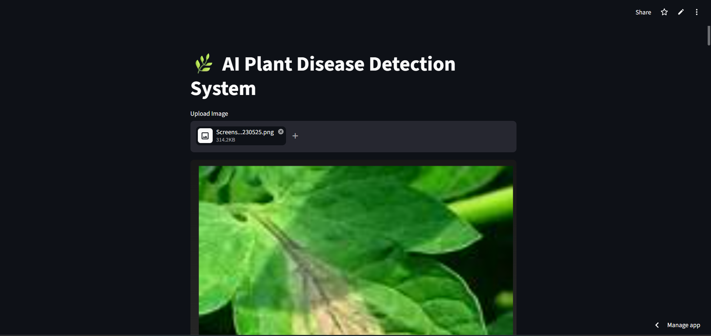
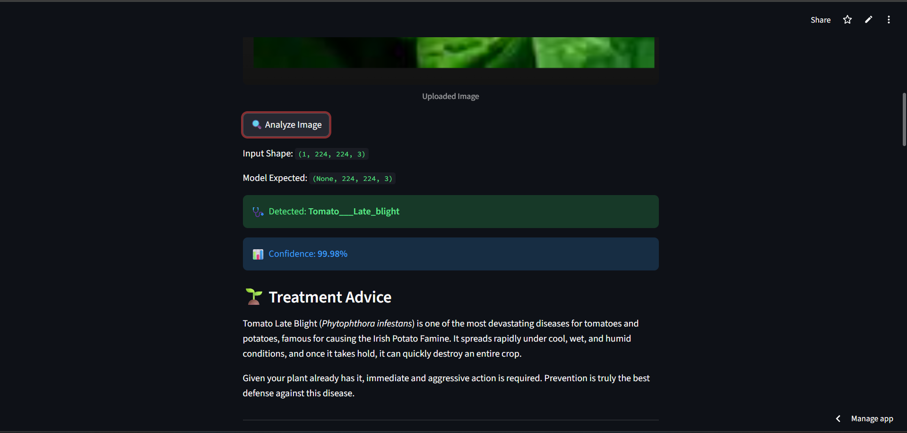
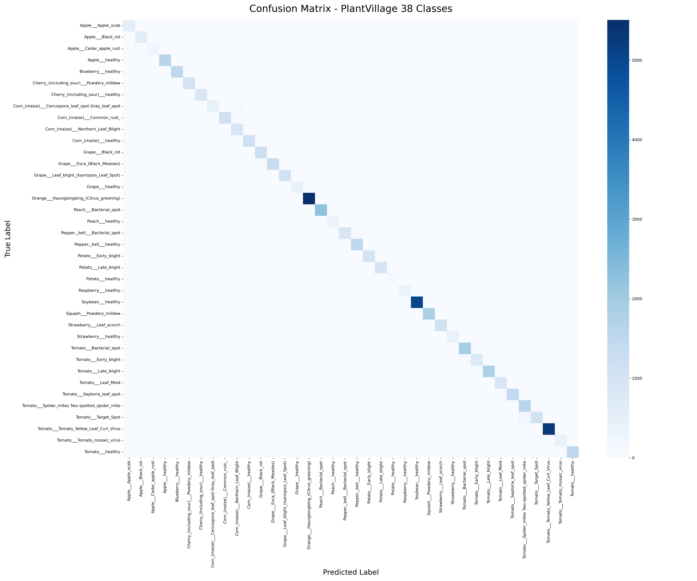
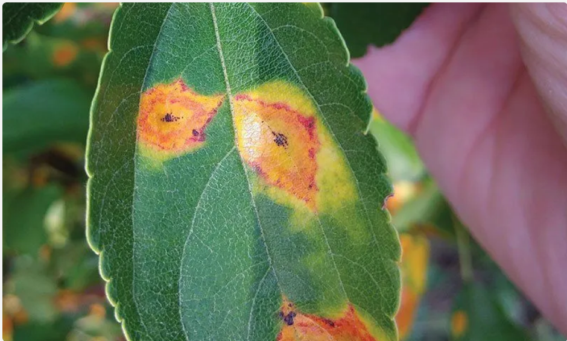
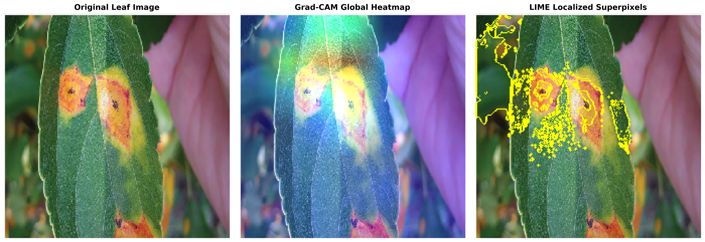

# 🌱 Agri-Vision: Explainable AI for Crop Disease Detection

[](https://iit-mandi-project-aaradhyaaashishnikam.streamlit.app/)

An **AI-powered agricultural diagnostic application** that combines deep learning, computer vision, and Explainable AI (XAI) to identify crop diseases from leaf images. Agri-Vision uses a trained deep learning model to classify plant diseases into 38 categories and integrates **Grad-CAM and LIME** to visually explain the model's predictions.

The application provides an interactive Streamlit dashboard featuring disease classification, confidence scores, visual explanations, and disease management guidance.

---

## 💡 Problem Statement

Crop diseases are a major challenge in agriculture, often resulting in reduced productivity and financial losses. Farmers may not always have immediate access to agricultural experts for identifying plant diseases.

Traditional deep learning models can classify plant diseases accurately but often operate as black boxes, providing predictions without explaining the reasons behind them.

**Agri-Vision** addresses this problem by combining image-based disease classification with Explainable AI techniques. It helps users identify potential crop diseases while visualizing the important regions of leaf images that influenced the model's predictions.

---

## 🚀 Key Features & Architecture

**Data Flow:**

`Leaf Image Upload` ➔ `Image Preprocessing` ➔ `Deep Learning Model` ➔ `Disease Classification` ➔ `Grad-CAM + LIME` ➔ `Streamlit Dashboard` ➔ `Treatment & Prevention Guidance`

* **38-Class Disease Classification:** Identifies plant diseases and healthy leaf conditions using the PlantVillage classification dataset.
* **Deep Learning-Based Detection:** Uses a trained Keras model for automated image classification.
* **Explainable AI (XAI):** Integrates Grad-CAM and LIME to visualize the image regions influencing predictions.
* **Grad-CAM Heatmaps:** Highlights important regions of leaf images contributing to the model's prediction.
* **LIME Superpixel Explanations:** Identifies localized image regions that influence the predicted class.
* **Prediction Confidence:** Displays the predicted disease and corresponding confidence score.
* **Top-3 Predictions:** Shows the three most probable classification results.
* **Disease Management Guidance:** Provides general treatment, organic solutions, and prevention methods.
* **Interactive Dashboard:** Provides an easy-to-use interface developed using Streamlit.
* **Model Evaluation:** Includes classification reports and confusion matrix visualization.
* **Hybrid CNN-Vision Transformer Research:** Includes experimental architectures combining CNN feature extraction and Transformer-based attention.

---

## 📸 System Previews

### 1. Disease Detection & Classification

Upload a leaf image and let the trained deep learning model identify the possible disease.



### 2. Model Accuracy & Evaluation

The following visualization presents the model's accuracy evaluation.



### 3. Confusion Matrix

The confusion matrix provides a class-wise view of actual versus predicted classifications across the PlantVillage categories.



---

## 🔍 Explainable AI (XAI) Visualizations

One of the major features of Agri-Vision is its Explainable AI integration.

Instead of displaying only the predicted disease, the application visualizes which regions of the leaf image influenced the model's decision.

### Original Leaf Image

The original leaf image provided to the classification model.



### Grad-CAM & LIME Analysis

The following visualization compares three outputs:

1. **Original Image:** The uploaded leaf image.
2. **Grad-CAM Global Heatmap:** Highlights the broader image regions that contributed to the model's prediction.
3. **LIME Localized Superpixels:** Highlights specific image regions that influenced the predicted class.



### Explainability Techniques

| Technique | Description |
|---|---|
| Grad-CAM | Generates gradient-based heatmaps to visualize important image regions. |
| LIME | Uses image perturbations and superpixel segmentation to explain individual predictions. |

---

## 💊 Disease Treatment & Management

Agri-Vision provides general disease-management guidance to help users understand possible treatment approaches.

### Treatment Steps


### Organic Solutions

The application presents organic approaches for crop disease management.


### Prevention Methods

The application also provides preventive measures to help reduce the spread and occurrence of crop diseases.


---

## 🧠 Model Architecture & Research

The project also explores hybrid CNN–Vision Transformer architectures for crop disease classification.

The research focuses on combining:

* **Convolutional Neural Networks (CNN):** Extract local visual features and disease-related patterns from leaf images.
* **Vision Transformer (ViT):** Uses self-attention mechanisms to capture global relationships between spatial image features.
* **Explainable AI:** Uses Grad-CAM and LIME to improve the interpretability of model predictions.

The repository includes experimental implementations using MobileNetV2 and EfficientNet-B0-based architectures.

---

## 🛠️ Technology Stack

| Category | Technologies |
|---|---|
| Programming Language | Python 3.12+ |
| Deep Learning | TensorFlow, Keras |
| Computer Vision | OpenCV, Pillow |
| Neural Network Architecture | CNN, MobileNetV2, Vision Transformer |
| Experimental Architecture | PyTorch, Torchvision, EfficientNet-B0 |
| Explainable AI | Grad-CAM, LIME |
| Image Segmentation | scikit-image |
| Data Processing | NumPy, Pandas |
| Model Evaluation | Scikit-learn |
| Data Visualization | Matplotlib, Seaborn |
| Frontend & Deployment | Streamlit |
| Research Environment | Jupyter Notebook |

---

## 📂 Project Structure

```text
Agri-Vision-IIT-MANDI-PROJECT/
│
├── app.py
├── train.py
├── evaluate_model.py
├── hybrid_cnn_vit.py
├── xai_analysis.py
├── Code.ipynb
├── requirements.txt
├── README.md
│
├── models/
│   └── model.keras
│
├── images/
│   ├── Accuracy.png
│   ├── classification_report.txt
│   ├── confusion_matrix.png
│   ├── hybrid_model_summary.txt
│   ├── Input.png
│   ├── Organic Solutions 1.png
│   ├── Organic Solutions 2.png
│   ├── Prevention Methods 1.png
│   ├── Prevention Methods 2.png
│   ├── test_leaf_image.png
│   ├── Treatment Steps 1.png
│   ├── Treatment Steps 2.png
│   └── xai_results.png
│
└── plantvillage dataset/
    └── color/

---

## ⚙️ Local Setup & Run (Windows PowerShell)

It is recommended to run this project in a virtual environment. All terminal commands are combined below for easy setup.

powershell
# 1. Clone the repository and navigate into it
git clone [[https://github.com/AaradhyaNikam/jaaniv-krushi.git](https://github.com/AaradhyaNikam/Agri-Vision-IIT-MANDI-PROJECT)]
cd jaaniv-krushi

# 2. Create and activate a virtual environment
python -m venv .venv
.\.venv\Scripts\Activate.ps1

# 3. Upgrade pip and install dependencies
python -m pip install --upgrade pip
pip install -r requirements.txt

# 4. Launch the Web Application
streamlit run app.py
---
Aaradhya Aashish Nikam 2nd-Year B.Tech Student, D.Y. Patil Engineering College, Pune * LinkedIn: www.linkedin.com/in/aaradhya-nikam-02a69b32a

Email: nikamaaradhya97@gmail.com
